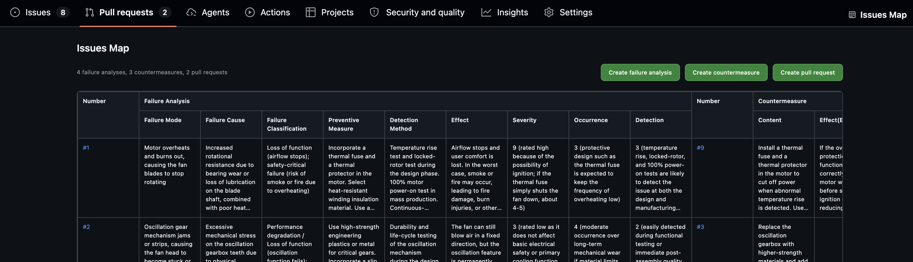
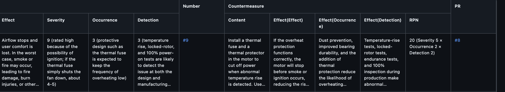

# Issue Map View

**See the full FMEA story in one place.** Issue Map View is a Chrome extension that turns Failure Analysis issues, Countermeasures, and pull requests into a live, spreadsheet-like map on GitHub repository pages. Follow how a failure connects to its corrective action and implementation PR—without manually piecing together separate issues.



## Why Issue Map?

- **Trace issues to implementation:** See which Countermeasures and pull requests are associated with each Failure Analysis.
- **Understand the relationships at a glance:** Each row brings related GitHub issues and PRs together, including one-to-many relationships.
- **Keep your workflow in GitHub:** Create and link issues and pull requests from drawers in the map, then continue working in the repository.
- **Use the FMEA information you already track:** Failure Mode, Cause, Classification, Preventive Measure, Detection Method, Effect, Severity, Occurrence, and Detection are shown alongside Countermeasure details and RPN.
- **Stay current while editing:** Issue changes update the map, and pull request relationships are reflected when you return to it.

## See it in action

The map groups Failure Analysis fields and Countermeasure fields into a single view. Long content wraps within fixed-width cells and is shortened when needed; hover over a cell to see its full text.



## How it works

Issue Map View uses GitHub issues as the source of truth:

| GitHub item | Label | Relationship |
| --- | --- | --- |
| Failure Analysis | `failure_analysis` | Identifies the failure mode, cause, risk, and detection information |
| Countermeasure | `countermeasure` | Links to one or more Failure Analyses with `Related failure analysis: #<number>` |
| Pull request | — | Links to issues with `Related to failure analysis #<number>` and `Related to countermeasure #<number>` |

New issues use the `failure_analysis` label and Failure Analysis terminology. Existing issues using the legacy `analysis_result` label, heading, or relationship syntax continue to be recognized.

## Install in Chrome

1. Clone or download this repository.
2. Open `chrome://extensions/` in Chrome and enable **Developer mode**.
3. Select **Load unpacked** and choose this repository's `src/` folder.
4. Open a GitHub repository page that has the **Code**, **Issues**, and **Pull requests** tabs. The **Issues Map** tab will appear in the repository navigation.

## Configure GitHub access

To list and modify repository issues and pull requests, configure a fine-grained personal access token in the extension options. Limit the token to the target repository and grant:

- **Issues: Read and write** — list, create, update, and link Failure Analysis and Countermeasure issues.
- **Pull requests: Read and write** — list pull requests and add issue references to their descriptions.
- **Projects: Read and write** — view and edit GitHub Projects v2 membership.

Open the extension's **Details > Extension options** page (or its popup), enter the token, and select **Save token**. The token is stored in `chrome.storage.session` and cleared when the browser session ends or the extension is reloaded.

## Run tests

Run the module and mocked browser test suites with:

```sh
npm test
```

Or run an individual suite with `npm run test:module` or `npm run test:e2e`. The mocked E2E suite uses Cucumber, Gherkin, and Playwright; it does not require GitHub login or make live GitHub changes. Test dependencies are installed under `test/node_modules`.

An opt-in live Chrome/GitHub test is available with `npm run test:live`. It uses the dedicated `AK1N0RI/issue_map_test` repository and a temporary Chrome profile. The test creates marked issues and updates a designated pull request; these GitHub changes are not automatically cleaned up. Review [`test/e2etest/README.md`](./test/e2etest/README.md) before running it.

For detailed behavior and relationship formats, see [`spec.md`](./spec.md).
